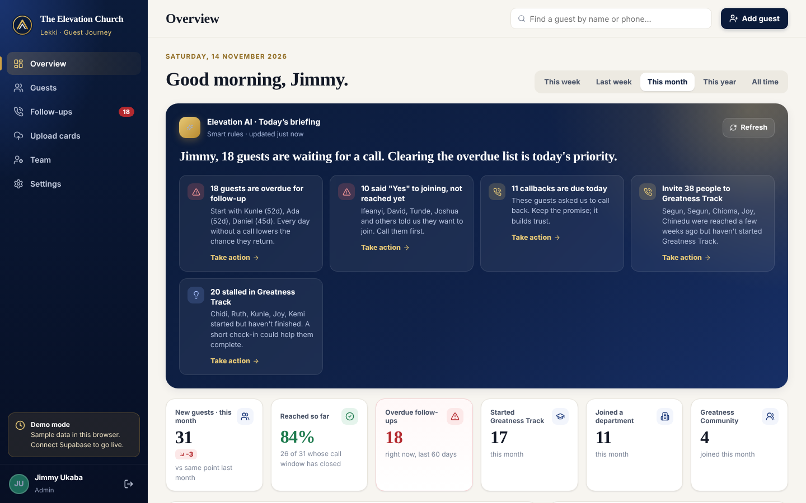
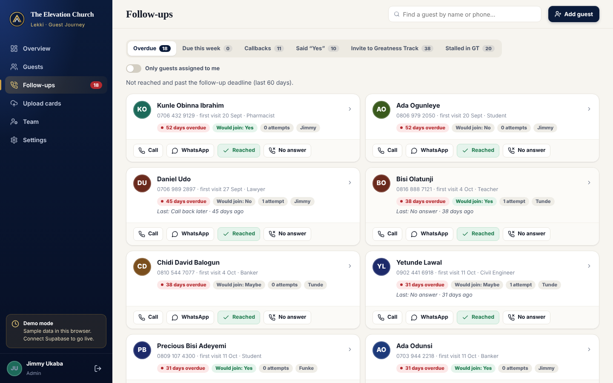
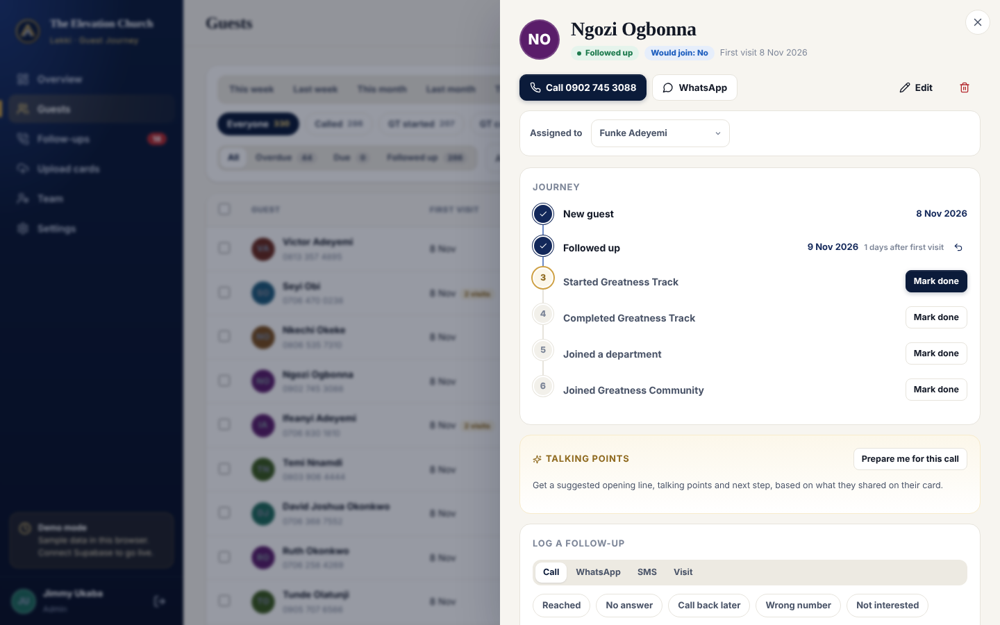

# The Elevation Church, Lekki: Guest Journey

Every Sunday, new guests fill in the **Guest Information Card**. This app makes sure none of them gets lost. It tracks each person from their first visit to joining the Greatness Community, tells the follow-up team who to call today, and gives leadership a live picture of the church's growth.



## What it does

| | |
|---|---|
| **Upload cards** | The acquisition team drops in the weekly Excel file (`public/guest-card-template.xlsx` has the card's columns). Phone numbers, ages and dates are cleaned automatically. Duplicates and returning guests are flagged before anything is saved, and new guests are shared out across the follow-up team. |
| **Guests** | Filter by this week, last week, this month, last month, this year or a custom range. Then filter by journey stage, follow-up status or who they're assigned to. Search by name or phone, bulk-reassign, and export to CSV. |
| **Journey** | Each guest moves through: **New guest → Followed up → Started Greatness Track → Completed Greatness Track → Joined a department → Joined Greatness Community**. Each step records its date. |
| **Follow-ups** | Ready-made call lists: **Overdue** (not reached by Wednesday, i.e. Sunday + 3 days), **Due this week**, **Callbacks**, **Said "Yes"**, **Invite to Greatness Track** and **Stalled in GT**. Call or WhatsApp in one tap and log the outcome. A "Reached" outcome marks the guest as followed up. |
| **Overview** | KPIs with fair comparisons, new guests per week, the discipleship funnel, how guests heard about the church, age groups, "would join" answers and team activity. |
| **Elevation AI** | A daily briefing at the top of the Overview, and "Prepare me for this call" talking points on every guest. Powered by **Groq's free tier (Llama 3.3 70B)**. If Groq isn't set up or is busy, built-in rules take over, so the panel always works. |
| **Team & roles** | Admin, Acquisition team, Follow-up team, Viewer (pastors). New sign-ups wait for an admin to approve them. Enforced by database Row Level Security. |

| Follow-ups | Guest profile |
|---|---|
|  |  |

## Demo mode

If Supabase isn't configured, the app runs with about 330 realistic **sample guests** kept in the browser. This is useful for showing the pastors right away. Once Supabase is connected, an admin can load the same sample data from **Settings → Load sample data** and clear it with one click before real cards are uploaded. Sample rows are flagged `is_demo`, so real guests are never touched.

## Setup

### 1. Supabase (database and logins)
1. Create a project at [supabase.com](https://supabase.com).
2. Go to **SQL Editor → New query**, paste the whole of [`supabase/schema.sql`](supabase/schema.sql) and click **Run**. It's safe to re-run.
3. **Authentication → Providers → Email**: keep it on. For a quick start you can turn off "Confirm email".
4. **Project Settings → API**: copy the **Project URL** and the **anon public** key.

The **first person to sign up becomes admin**. Everyone after that waits for approval on the **Team** page.

### 2. Groq (free AI)
Create a key at [console.groq.com/keys](https://console.groq.com/keys). No card is needed for the free tier.

### 3. Vercel (hosting)
1. Import this repo in Vercel. The framework preset is "Other"; `vercel.json` already sets the build.
2. Add these **Environment Variables**:

| Name | Value |
|---|---|
| `SUPABASE_URL` | your Project URL |
| `SUPABASE_ANON_KEY` | your anon public key |
| `GROQ_API_KEY` | your Groq key (server-only, never sent to the browser) |
| `GROQ_MODEL` | optional, default `llama-3.3-70b-versatile` |

3. Deploy, open the site and sign up. You're the admin.

## Local development
```bash
npm install
cp .env.example .env.local   # fill in values, or leave empty for demo mode
npm run build                # outputs dist/
npx serve dist               # or: npm run dev (rebuilds on change)
```
The `/api/insights` function runs on Vercel (`vercel dev` locally).

## How it's built
- **Front end:** React 19, bundled by esbuild (`scripts/build.mjs`) into a static site. It talks to Supabase's REST and Auth APIs directly, so no SDK is needed.
- **Database:** Supabase Postgres with Row Level Security (`supabase/schema.sql`). There's one `guests` row per person (fields mirror the card), a `followups` log, `uploads`, `settings` and `profiles`.
- **AI:** `api/insights.js`, a Vercel serverless function. It checks the user's Supabase session, then calls Groq in JSON mode.
- **Privacy:** the AI only receives first names, journey stages and card answers such as occupation and interests. **Phone numbers, emails and prayer requests are never sent to the AI.**

| Path | What's there |
|---|---|
| `src/pages/` | Overview, Guests, Guest profile drawer, Follow-ups, Upload, Team, Settings, Login |
| `src/lib/journey.js` | Stages, follow-up deadline and overdue rules, date periods |
| `src/lib/excel.js` | .xlsx/.csv reader, column matching, data cleaning |
| `src/lib/ai.js` | AI briefing input, rule-based fallback |
| `src/lib/backend.js` | Supabase client and demo backend |

## Changing things
- **Follow-up window, Greatness Track "stalled" weeks, departments:** change these in the app under **Settings** (admin).
- **Logo:** replace `public/logo.svg` with the church logo (same file name).
- **New card fields:** add a column in `supabase/schema.sql`, a matcher in `FIELDS` in `src/lib/excel.js`, and an input in `src/pages/GuestForm.jsx`.

## Roadmap
- QR code on the seats that opens a digital guest card (no more typing on Monday)
- AI reading of photographed paper cards
- Automatic WhatsApp or SMS welcome messages, and reminders for the follow-up team
- Weekly email or Teams summary for the pastors
